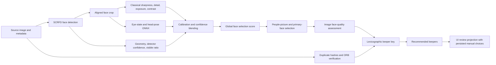

# Phase 8G face-quality and keeper-ranking audit

## Scope and reproducibility

This is a measurement baseline. No production scoring weights, thresholds, models,
duplicate matching, keeper rules, or stored reviews were changed. The audited
branch is `qt-qml-export-phase8d`, at `7a9d60275063ea0a9277eabbc36beade20cd9590`.
The audit runner's own SHA-256 is recorded separately in each manifest because
the diagnostic tool is added after that branch commit.

Run a fresh analysis with an isolated database and optional blind contact sheets:

```powershell
.\.venv\Scripts\python.exe -m app.tools.audit_face_quality --input "C:\path\to\photos" --output "C:\path\to\audit_results" --mode full --provider automatic --contact-sheets
```

To evaluate an existing compatible analysis cache without writing it, use
`--mode cached --cache-source "C:\path\to\image_analysis_cache.sqlite3"` and a
new output directory. The runner copies the database using SQLite backup.
An interrupted run can be restarted with the same command and output path;
`image_checkpoint.jsonl` records completed images. The manifest rejects a
different dataset signature, code revision, provider request, or tool revision.
`--checkpoint-source path\to\image_checkpoint.jsonl` imports a verified prior
checkpoint into a new output directory, preserving its original face
measurements while regenerating ranking and summary CSVs. The source manifest
must match the dataset and model fingerprints; commits between the source and
current HEAD may change only this audit tool, its tests or this report.
`--max-images N` selects the first N lexicographically sorted files for a smoke
test. The source directory is read only and the output directory must be outside it.

The audit analyzes every listed source image; it does not run blur exclusions,
embedding generation, recognition, unknown clustering, or application review
projection. It recomputes the existing people-picture and image-quality
assessments, uses the production duplicate hash/ORB grouping unless an explicit
`--groups-csv` is supplied, then calls the unchanged production keeper selector.
The fixed evaluation configuration is serialized in `manifest.json`.

## Pipeline dependency map



`face_analyzer/classical_metrics.py` calculates crop-based tonal and detail
measurements. `face_analyzer/eye_state.py` and `head_pose.py` estimate eye state
and pose. `default_face_analyzer.py` converts these to calibrated metric scores
with `face_analyzer/ranking.py`, blends low-confidence values toward neutral
priors, and computes `global_selection_score` using the current weights
(sharpness .30, eyes .23, pose .15, exposure .10, contrast .07, detail .05,
detector .04, reliability .04, visible ratio .02). Recognition utility uses a
separate `embedding_utility_score`; eye closure is not part of that score.

`face_processing/cache.py` persists per-face raw, quality, calibration,
confidence, selection and embedding-utility fields in the analysis cache.
`automatic_scan/eligibility.py` identifies reliable/prominent primary faces and
assesses their quality. It computes acceptable-primary count, worst primary
score, area/reliability-weighted average, closed-eye count, and terminal
warnings. `project_pipeline.py` puts these assessments in `PipelineImageState`
and passes them to `automatic_scan/duplicate_selection.py`. The latter sorts
each verified duplicate group. `ui/qt/duplicate_data.py` exposes recommended
keepers, explanations, and separately persisted manual review choices. The
people-card preview code reads a small subset of cached selection/exposure
scores but does not drive duplicate recommendations.

`scripts/analyze_face_quality_distribution.py` exports face-level distribution
statistics and correlations. `scripts/generate_face_ranking_calibration.py`
proposes percentile knots from a supplied CSV; it does not deploy a new
calibration profile. `apply_group_relative_ranking()` is called by the former
diagnostic script and tests, not by the production duplicate keeper path.

| Signal | Calculated and calibrated | Keeper path and UI exposure |
|---|---|---|
| Sharpness and detail | Aligned crop in `ClassicalFaceQualityAssessor`; calibrated in `DefaultFaceAnalyzer` | Both enter global face score. Primary-face aggregate reaches keeper tuple. No independent whole-photo sharpness field is populated. |
| Eyes and confidence | Eye ONNX estimates each eye, then confidence-blended ranking | Global face score and thresholded closed-eye primary count; duplicate eye field is binary-like. UI shows a generic recommendation explanation, not probabilities. |
| Head pose | Pose ONNX and `_pose_quality()` calibration | Global face score and extreme-pose warning; separate duplicate pose field stays zero. |
| Exposure and contrast | Aligned-crop tonal metrics and calibration curves | Global face score, warnings and some terminal checks; duplicate exposure/contrast field stays zero. |
| Visible face and occlusion | Geometry visible-ratio estimate; no separate learned occlusion measure | Global score, primary prominence and warning. Duplicate pose/visibility field stays zero. |
| Detector confidence | SCRFD confidence calibrated in face analyzer | Global score and embedding utility; no direct duplicate tuple field. |
| Measurement reliability | Weighted metric confidences | Global score, primary-face eligibility/prominence and aggregation weight. |
| Primary faces | `assess_people_picture()` prominence/reliability/area rules | Determines which face scores count in worst/weighted/count fields. |
| Multiple people | `assess_face_quality()` counts acceptable primaries, takes worst score and area/reliability weighted average | Count has highest lexicographic priority; worst score has second priority. |

The numeric face measurements are exposed in the audit CSV, while the normal
application surfaces high-level warnings, review status and keeper explanations.

## Confirmed implementation findings

| Finding | Evidence and effect |
|---|---|
| Four duplicate breakdown fields are placeholders | `pose_visibility_score`, `image_sharpness_score`, `exposure_contrast_score`, and `overall_quality_score` are assigned `0.0` in `_ranking_breakdown()`. They never distinguish candidates at their tuple positions. Pose, visibility, crop sharpness, exposure and contrast can still affect earlier face selection scores and thus the primary-face aggregate. No independent whole-image exposure/sharpness term is used. |
| Two keeper preference switches are ignored | `prefer_open_eyes` and `prioritize_primary_face_quality` exist in `DuplicateSelectionConfig` and Settings, but `select_duplicate_keepers()` reads only `keepers_per_group`. Toggling either switch currently cannot change a keeper recommendation. This is a confirmed functional gap; the diagnostic phase does not change the sorter. |
| Lexicographic priority can dominate quality magnitude | The sort key compares acceptable-primary count before worst score, worst score before weighted average, and so on. A difference of `0.000001` in worst score outranks any weighted-average improvement. There is no tolerance or cross-field tradeoff. |
| Missing face measurements can affect ties | Missing assessments become zero for primary count/scores, while `eye_open_score` defaults to `1.0` unless a closed-eye primary is reported. That value does not mean eyes were measured as open. |
| Eye confidence is compressed for duplicate sorting | The face assessor uses eye confidence in the weighted face score and thresholded closed-eye count. The duplicate-level `eye_open_score` is only `1.0` or `0.5`; confidence is not represented directly at that tuple position. |
| Primary-person errors can propagate | Primary-face choice depends partly on relative area, span, visibility, global score, reliability and center position. Misidentified primary faces alter counts and aggregated scores before keeper selection. |
| Manual decisions are separate | The UI projection uses persisted keeper/review choices when their group revision is valid. The audit exports recommendations only and never writes those decisions. |
| Manual-choice validity depends on keeper count | `project_duplicate_rows()` also requires the saved keeper count to match the recommendation count. Changing `keepers_per_group` can make an otherwise unchanged saved choice fail that validity check. This is a review-preservation risk to test before a later fix. |
| Cached eye metrics do not round-trip exactly | The isolated cached run preserved ranking outcomes but lost 5,091 non-null fresh eye ranking values and changed 3,074 eye raw/quality scores. The cache reconstructs `eyes` from `eye_state` rather than persisting all fields independently. The audit keeps fresh measurements as the baseline. |

The default tuple order is: acceptable-primary count, worst-primary score,
weighted-primary average, eye-open score, the four zero placeholders, visual
centrality, *older* capture time, and path. `ranking_decisions.csv` reports
the first different field versus the winner and its margin.

## Human review workflow

Run with `--contact-sheets` to produce one blind JPEG sheet per comparison
group in `contact_sheets/`. Sheets show source filenames but no Room36
recommendation. Open originals separately to zoom. Fill a copy of
`review_annotations_template.csv`: mark `preferred_keeper`,
`equally_acceptable`, `unusable`, or `uncertain` with `1`; place reason tags in
`reasons` separated by `|`. Suggested tags: `blur`, `closed_eyes`,
`poor_expression`, `head_pose`, `wrong_primary_person`, `occlusion`,
`bad_exposure`, `composition`. For quantitative pairwise evaluation, provide
`--labels-csv` with `image_a,image_b,preferred_image` and optionally `group_id`.
`preferred_image` may be one path or `tie`, `equal`, or `uncertain`. Neither
annotation file nor contact sheets modify sources or Room36 reviews.

Use one labeled development set for candidate strategy design and a separate,
held-out labeled set for evaluation. No alternative weights should be tuned on
the held-out set.

## Export contract

- `face_metrics.csv`: one row per detected face; flattened raw/calibrated metric
  fields, confidences, warnings, selection/utility scores and primary flag.
- `photo_metrics.csv`: one row per source photo; primary counts and aggregate
  scores, quality outcomes and cache/error state.
- `ranking_decisions.csv`: one row per duplicate candidate with every sort
  field, position, keeper flag, first decisive field and margin.
- `pairwise_comparisons.csv`: every pair within each group, baseline preference,
  optional human preference and differences.
- `audit_summary.csv`: counts, agreement where labels exist, missing-analysis
  and terminal-failure rates by scenario.
- `manifest.json`: source signature, models, provider request/runtime, config,
  face calibration profile, ranking weights, metric priors, CPU/RAM identity,
  dependency and tool/code versions, cache isolation, counts, CSV columns and
  completion state.

Numeric CSV cells contain no units. Missing metrics and unavailable human
accuracy are empty, not zero. Source paths are kept so rows can be joined or
reviewed. Group IDs are the production SHA-based IDs from group member paths.

## Baseline results and limitations

The local `room36_test_set/NSC_Meeting` full run completed under the automatic
provider choice (active SCRFD providers: DirectML, then CPU). It analyzed
**1,732 photographs and 8,453 faces**, with **zero photo failures** and zero
face-cache hits. The production duplicate matcher found **8 groups, 17
candidates and 10 candidate pairs**; six groups contain group photos and two
have no primary face. No single-person duplicate groups were found in this
dataset. Eight blind contact sheets were exported. The fresh measurement
checkpoint was imported into `audit_results/phase8g_nsc_release_20261102` to
regenerate the final CSV schema. Fresh and final face, photo, ranking and
pairwise CSVs are byte-identical.

| Metric | Measured baseline |
|---|---:|
| People pictures | 1,382 / 1,732 |
| Terminal image-quality failures | 35 / 1,732 (2.02%) |
| Faces missing at least one eye probability | 60.11% |
| Faces missing head-pose yaw | 0.89% |
| Faces below 0.36 reliability | 0.40% |
| Global face selection score, p10 / median / p90 | 0.416 / 0.558 / 0.788 |
| Worst primary score, p10 / median / p90 (people pictures) | 0.367 / 0.480 / 0.698 |

The per-face eye ranking has a median of **0.212**, with 1,481 values at 1.0;
5,091 eye-state results are marked low confidence. Visible-face ranking is
exactly 1.0 for 8,341 of 8,453 faces (98.7%), so it has little discrimination
on this dataset. Pose ranking is 1.0 for 2,376 faces (28.1%). Exposure ranking
has p10/median/p90 of 0.660/0.932/0.944, suggesting compression near the
upper end. These are distribution observations, not evidence that a calibration
change would improve human preference. Face sharpness and global selection
scores correlate at about 0.847; eye ranking and global selection at about
0.644. These correlations partly follow the current score formula.

Among the nine non-winning candidates, the first deciding criterion was worst
primary score four times, acceptable-primary count three times, capture time
once, and path once. The `IMG_3955.JPG` versus `IMG_3956.JPG` group illustrates
a lexicographic tradeoff: the winner's worst-primary score is only 0.00146
higher while its weighted-primary average is 0.00938 lower. Another group,
`IMG_4184.JPG` versus `IMG_4183.JPG`, has a 0.00382 worst-score advantage and
a 0.01068 weighted-average disadvantage. These are blind-review candidates,
not confirmed wrong decisions.

**Fresh versus cached measurement discrepancy:** a separate cached run loaded
all 1,732 faces records and produced byte-identical ranking and pairwise CSVs,
but its face CSV differed. On cache restoration, `eyes.ranking_score` became
missing for 5,091 faces and `eyes.raw_value`/`quality_score` changed for 3,074
faces. `face_processing/cache.py` reconstructs the eye metric from
`eye_state.combined_open_score` and sets ranking to `None` when that score is
missing, even when the fresh analyzer stored a calibrated neutral ranking.
The fresh analyzer also rounds assessed eye probabilities before deriving its
eye metric. The persisted global selection score remains intact, explaining
why keeper ranking did not change here. Cached exports should not be used as
raw-metric ground truth until this fidelity issue is addressed in a later
implementation phase.

No human labels were supplied, so top-1/top-2 agreement, pairwise accuracy,
correct within-group ordering and improvements from alternative strategies
cannot be claimed. The scenario categories in this export are based on
primary-face count; expression, composition, and true primary-person identity
require annotation. The source signature uses path, size and modification
time, not a content hash of every photo. The eight observed groups are too few
for a robust claim about keeper-selection accuracy.

## Ranked recommendations for a later implementation phase

1. Make the two user-facing keeper preference switches effective or remove
   them; validate behavior with labeled pairs and manual-review preservation.
2. Measure whether zero placeholder fields should be populated with reliable
   whole-image signals or removed from the decision display.
3. Evaluate lexicographic tolerance/hybrid scoring offline, particularly
   near-ties in worst-primary score and multi-person groups.
4. Add an explicit unknown-eye state to duplicate-level diagnostics before
   interpreting `eye_open_score=1.0` as an open-eye result.
5. Review primary-person mistakes using blind labels before changing prominence
   thresholds. Track single-person and group-photo regressions separately.

Suggested acceptance criteria for any later change: no loss of manual keeper
choices; no worse held-out top-1/top-2 or pairwise accuracy by scenario; a
reported confidence interval and sample count for each improvement; no rise
in missing-analysis or stage failure rates; unchanged cache compatibility for
measurement-equivalent runs; explicit tests for eyes, occlusion, missing values,
near-ties, and multiple primary faces.
